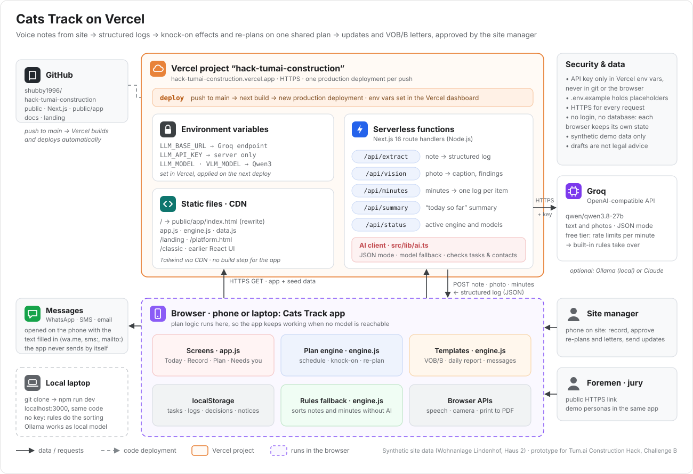
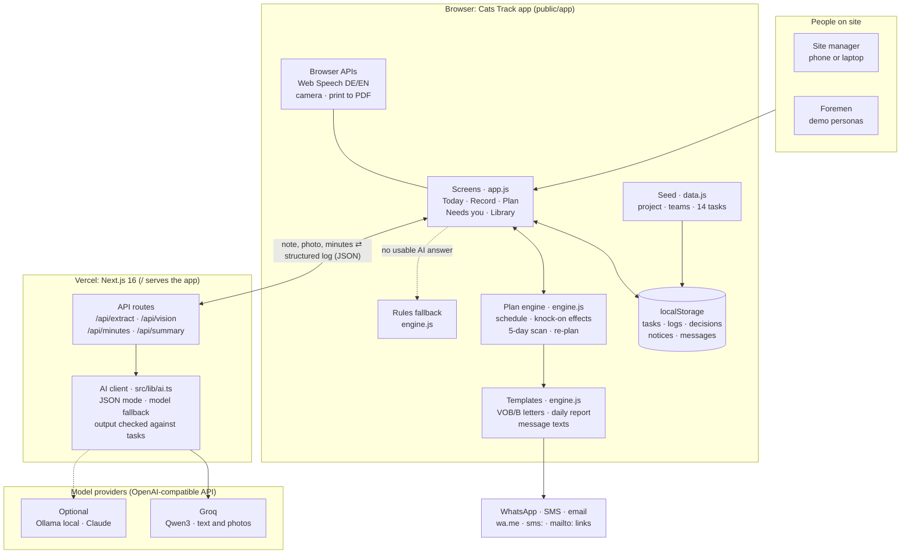
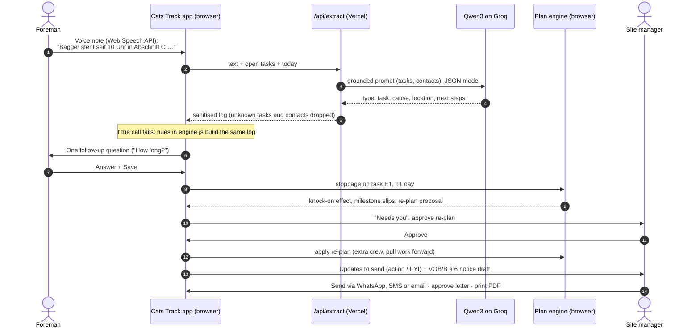
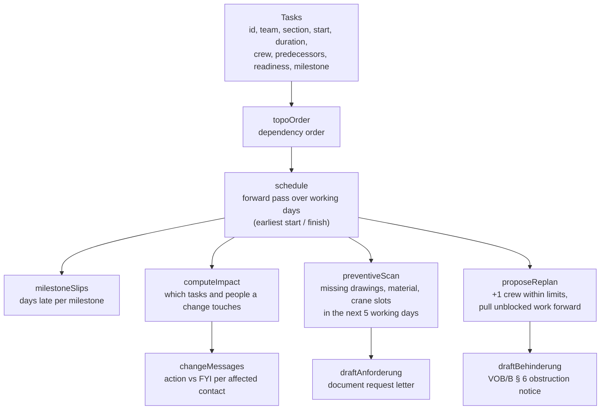
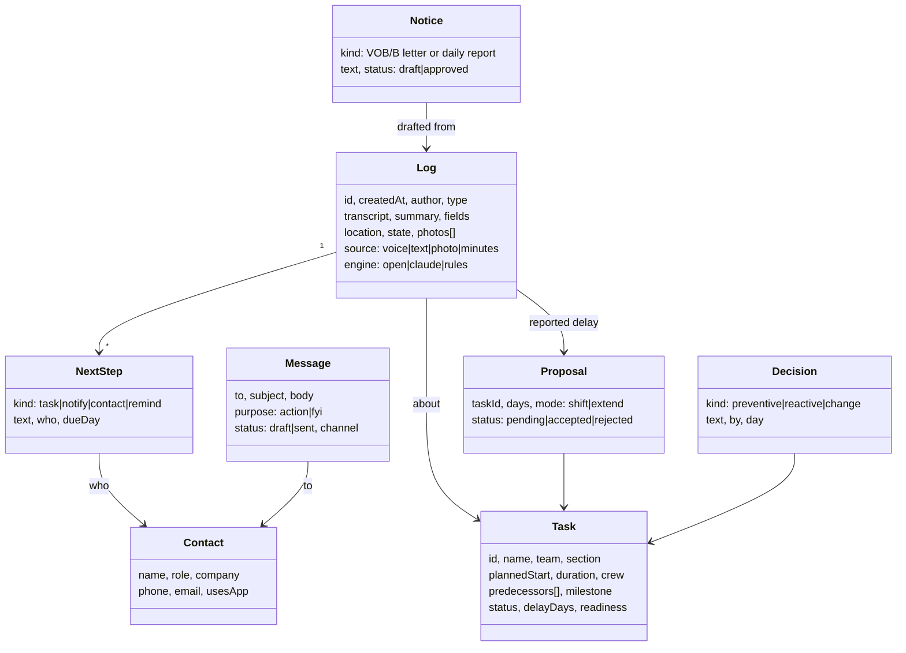

# Cats Track – prototype architecture

What runs today at [hack-tumai-construction.vercel.app](https://hack-tumai-construction.vercel.app) (Tum.ai Construction Hack, Challenge B).
The plan logic runs in the browser; only the language work goes to the server, which calls open-source models.
Synthetic demo data, no login, no database: each browser keeps its own state.

The diagrams below show the same system in more detail. They are written in Mermaid, so GitHub draws them from the text.

## 1. System overview

**Why this split:** the schedule logic is deterministic and small, so it runs instantly in the browser and works even when no model is reachable. The API key stays on the server. Every model answer is checked against the real task list and contacts before the app uses it.

## 2. One note, end to end

## 3. Plan engine

## 4. Main data objects (browser state)

## 5. Where things live

| Path | What it is |
| --- | --- |
| `public/app/index.html` | Entry page of the live app (Tailwind via CDN) |
| `public/app/app.js` | All screens, state, actions; calls the API routes |
| `public/app/engine.js` | Plan engine, rule-based note and minutes parsing, VOB/B and report templates, message texts |
| `public/app/data.js` | Seed project: Wohnanlage Lindenhof, Haus 2 – teams, tasks, contacts, sample notes |
| `src/app/api/extract` | Note → structured log (open model, Claude, or rules) |
| `src/app/api/vision` | Photo → caption, findings, text in the image |
| `src/app/api/minutes` | Meeting minutes → one log per agenda item |
| `src/app/api/summary` | "Today so far" summary from the day's facts |
| `src/app/api/status` | Which engine and models are active (`?check=1` asks the provider) |
| `src/lib/ai.ts` | OpenAI-compatible client: JSON parsing, model fallback, Groq-specific settings |
| `src/app/classic` | Earlier React UI, still reachable at `/classic` |
| `public/landing`, `public/platform.html` | Landing page, platform documentation |

## 6. Configuration

| Variable | Purpose |
| --- | --- |
| `LLM_BASE_URL` | OpenAI-compatible endpoint, e.g. `https://api.groq.com/openai/v1` or a local Ollama |
| `LLM_API_KEY` | Provider key (server only, never sent to the browser) |
| `LLM_MODEL`, `VLM_MODEL` | Text and vision model; if one is not available, the client falls back to the other |
| `ANTHROPIC_API_KEY` | Optional: Claude instead of an open model |

Without any key, every feature still works with the built-in rules.

## Limits of the prototype

- No login or shared database: state lives in each browser's localStorage, so team members don't see each other's changes.
- Messages open WhatsApp, SMS or email with the text filled in; the app does not send them or read replies.
- PDF export uses the browser's print dialog.
- Drafted letters are a drafting aid, not legal advice; the site manager reviews and approves them.
